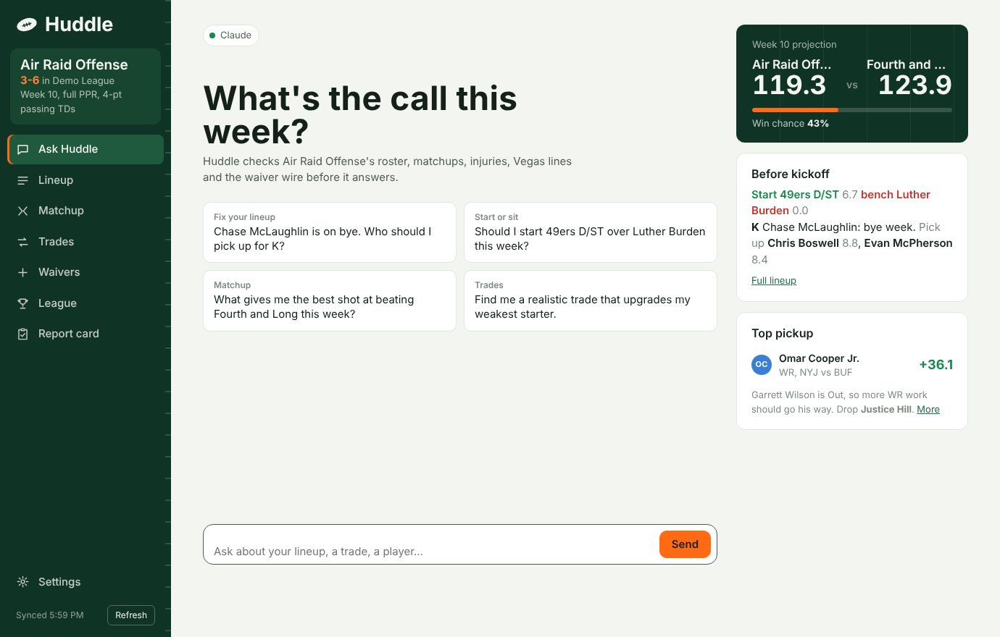
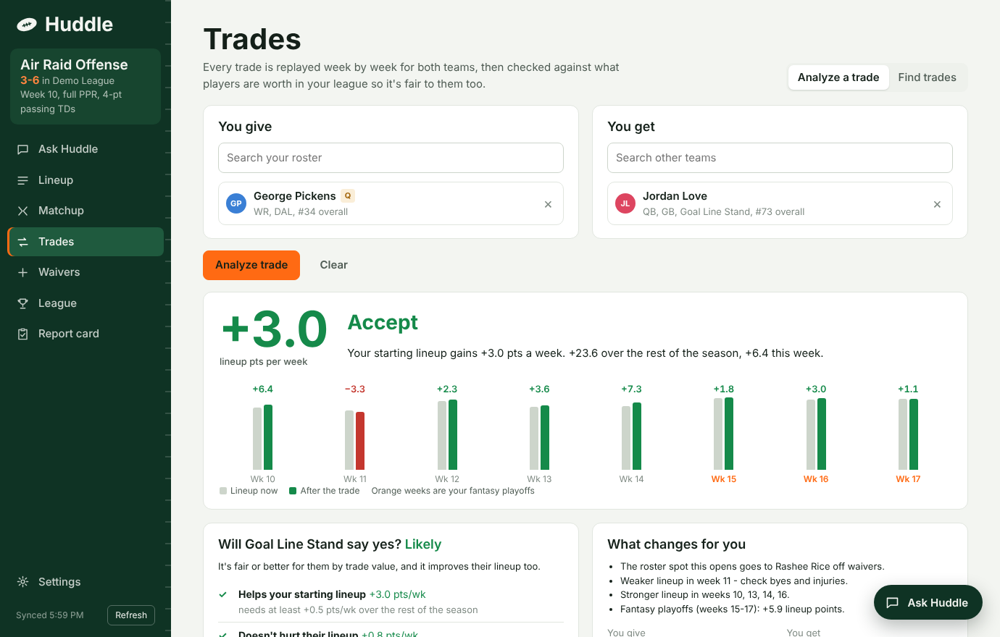
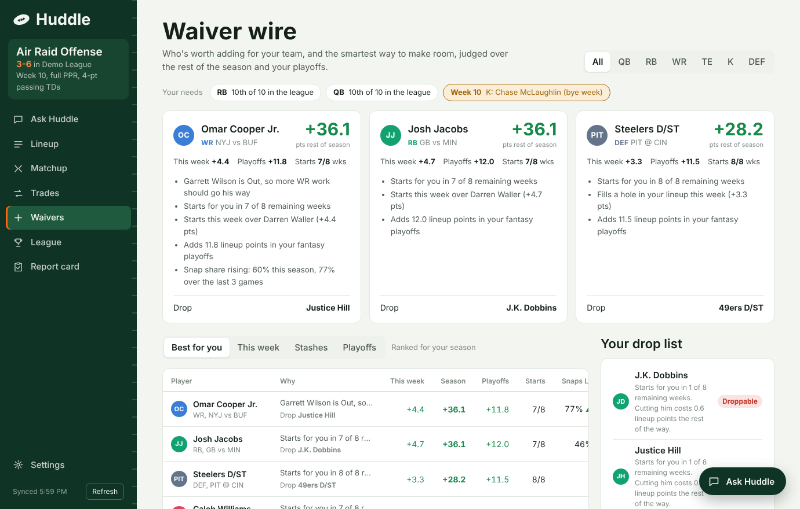
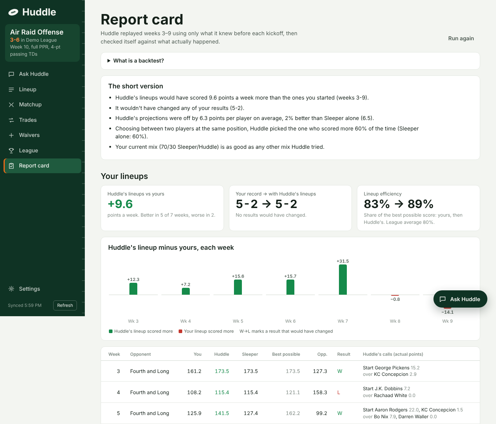
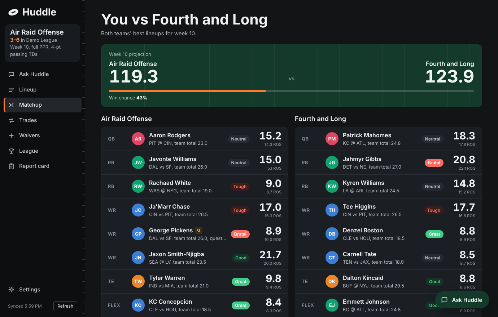

# Huddle

**An AI fantasy football assistant for Sleeper leagues that runs on your own computer.**




Huddle syncs your Sleeper league, re-scores every game of the NFL season with your league's exact scoring rules, and projects every remaining week. It turns that into lineup, trade and waiver advice for *your* roster. Ask it questions in plain English and it answers by running those calculations on your league. The chat can use your Claude or ChatGPT subscription, a free local model, or an API key.

Everything runs on your machine. There's no account, no server and nothing to host.

## Features

- **Lineup**: the best lineup for any remaining week, the exact changes to make in Sleeper, and free agents who fill bye-week or injury holes.
- **Matchup**: both teams' best lineups for the week and your chance to win.
- **Trade analyzer**: replays every remaining week with and without a trade, for *both* teams. It accounts for byes, injuries, roster limits, waiver pickups and the fantasy playoffs, then tells you whether the other manager would realistically accept.
- **Trade finder**: tests every 1-for-1, 2-for-1 and 1-for-2 deal in your league. It keeps only the ones that help you and that the other manager would actually take.
- **Waiver wire**: who's worth adding for your team and why (a rising snap share, a teammate's injury, a soft schedule), plus the smartest way to make room. FAAB leagues get a bid range.
- **Report card**: a backtest. Huddle replays every finished week using only what it knew before kickoff, then grades itself. It reports how accurate its projections were next to Sleeper's, and what its lineups would have scored with your real roster.
- **Player reports**: injury and practice status, snap share, target share, recent games, Vegas totals, stadium and weather.
- **Defense vs position**: how many fantasy points every defense allows to each position, in your scoring.
- **Ask Huddle**: a chat that's available on every page. It shows what it's doing while it works and notifies you when the answer is ready.
- **Light and dark themes.**

| Trade analyzer | Waiver wire |
|---|---|
|  |  |

| Report card (backtest) | Dark mode |
|---|---|
|  |  |

## Quick start

### What you need

- **macOS or Linux.** Windows isn't tested; [WSL](https://learn.microsoft.com/windows/wsl/install) should work.
- **Python 3.9 or newer.** Check with `python3 --version`. If you don't have it, install it from [python.org](https://www.python.org/downloads/) or with `brew install python`.
- **A Sleeper league.** Huddle reads Sleeper's public data, so you only need your Sleeper username, not your password.
- **Optional:** an AI for the chat (see [Set up the AI chat](#set-up-the-ai-chat-optional)). Everything else works without one.

### Install and run

```bash
git clone https://github.com/YOUR-USERNAME/huddle.git
cd huddle
./run.sh
```

The first run creates a private Python environment in `.venv` and installs the dependencies, which takes about a minute. After that, Huddle starts in a few seconds. Your browser opens to **http://127.0.0.1:8765**.

On a Mac you can also double-click **`Huddle.command`** in Finder. The first time, macOS may ask you to right-click it and choose **Open**.

To stop Huddle, press **Ctrl+C** in the Terminal window.

Options:

```bash
./run.sh --port 9000      # use a different port
./run.sh --no-browser     # don't open a browser tab
```

### Connect your league

1. Open **Settings**.
2. Enter your Sleeper username and select **Find my leagues**.
3. Pick your league and select **Save**.

The first sync downloads this season's stats, which takes about a minute. Use **Refresh** in the sidebar whenever you want the latest rosters, injuries and stats.

## Set up the AI chat (optional)

In **Settings > AI for Ask Huddle**, pick one option. Settings only shows the fields that option needs, and tells you when it's ready.

| Option | What you need | Cost |
|---|---|---|
| **Claude** (default) | A Claude Pro or Max subscription, plus [Claude Code](https://code.claude.com/docs/en/overview) installed and signed in | Included in your plan's usage limits |
| **ChatGPT** | A ChatGPT Plus (or higher) subscription, plus [Codex](https://developers.openai.com/codex/cli) installed and signed in | Included in your plan's limits |
| **Free** | [Ollama](https://ollama.com) and a downloaded model (for example `ollama pull qwen3:8b`) | Free; weaker answers |
| **API key** | An Anthropic or OpenAI API key | Billed per question |

**Claude, using your subscription.** Claude Code is Anthropic's command-line version of Claude. Huddle runs it in the background, so answers show up inside Huddle. Run this once in Terminal, and sign in with the account that has your subscription:

```bash
curl -fsSL https://claude.ai/install.sh | bash
claude auth login
```

**ChatGPT, using your subscription.** Same idea with Codex, OpenAI's command-line tool. Choose **Sign in with ChatGPT**:

```bash
curl -fsSL https://chatgpt.com/codex/install.sh | sh
codex login
```

Then select **Check again** in Settings.

**What the AI is allowed to do.** Whichever AI you pick, it only gets Huddle's read-only tools (lineup, player reports, trades, waivers, matchups, standings and the report card), plus your league and your advice-style preferences. Its own tools for running commands, editing files and browsing are turned off, and it runs in an empty folder. When you choose the subscription options, Huddle ignores any API key in your environment, so your subscription is what gets used.

Optional: `./run.sh --connect-claude` also adds Huddle's tools to the Claude desktop app.

## How it works

```
Sleeper API (free, no login)          nflverse open data (GitHub)
 rosters, scoring rules, lineup        weekly stats, snap counts, injury reports,
 slots, matchups, projections,         schedule with Vegas lines, roof, surface,
 trending adds                         weather; player ID crosswalk
              \                          /
               League context (huddle/model.py)
               - re-scores every game this season with your league's rules
               - builds defense-vs-position tables
               - projects every remaining week (Sleeper's projection blended with
                 Huddle's own model), then applies byes and injuries
               - values players against your league's actual waiver wire
                           |
       lineup solver, trade engine, waiver ranker, backtest, reports
                           |
       local web app (FastAPI + plain JavaScript)  <->  AI chat with 12 tools
```

### Projections

Each weekly projection blends Sleeper's projection (70% by default, adjustable in Settings) with Huddle's own model:

- **Scoring rate:** recent points per game, with the last 3 games counting double.
- **Matchup:** how many points the opponent allows to that position, compared with the league average.
- **Vegas:** the team's implied point total, from the spread and over/under.
- **Availability:** zero on byes and for players who are out or on IR. Questionable players count at 85% and doubtful players at 20%.

If Sleeper's projections are unavailable, Huddle keeps working on its own model and says so in the sidebar.

### Lineups

The best lineup is an assignment problem: players to slots, with FLEX and SUPER_FLEX eligibility. Huddle solves it exactly with the Hungarian algorithm (`scipy.optimize.linear_sum_assignment`), rather than filling slots one at a time.

### Trades

A 2-for-1 is only worth it if the extra player would actually start. So for every remaining week, Huddle re-solves the best possible lineup for both teams, before and after the trade:

- The team that receives more players has to cut someone.
- The team that receives fewer picks up the best free agent.
- Both sides are assumed to make every worthwhile waiver move anyway, so the trade only gets credit for what it changes.
- Fantasy-playoff weeks count 25% extra.

Then the trade is checked from the other manager's side:

1. **It helps your starting lineup** by at least 0.5 points a week.
2. **It doesn't hurt theirs.** If they'd give up the best player in the deal, their lineup can't get worse at all, because managers almost never do that.
3. **It's fair to them by trade value.** A player's trade value is what he's worth above your league's waiver wire. Market value is 65% expert consensus ranking (FantasyPros, via DynastyProcess) and 35% Huddle's projections. In small leagues good players sit on waivers, so two depth players don't add up to a star. Anyone the other manager would have to cut counts against the deal.

"Likely" trades pass every check. The finder never shows "unlikely" deals, and it lists "likely" ones first.

### Report card (backtest)

For each finished week (starting at week 3, once there's some history), Huddle pretends it's the morning of kickoff. It uses only:

- stats from earlier weeks,
- matchup ratings built from earlier weeks,
- that week's Vegas lines and official injury report,
- Sleeper's projection for that week.

Then it compares itself with what happened:

- **Projection accuracy:** the average number of points each projection missed by, and how often it picked the higher scorer of two players at the same position (the start/sit question). It reports these for Huddle, Sleeper alone, Huddle's model alone and plain season averages, all graded on the same games.
- **Best mix:** it tries every Sleeper/model mix. It only suggests switching when a different mix is clearly better and holds up in most weeks.
- **Your lineups:** your real roster each week, the lineup Huddle would have started, what it would have scored, the best lineup possible in hindsight, and any results that would have changed.

A test checks that the replay can't peek at the future. It scrambles every stat from the replayed week onward and confirms the projections don't change.

## Privacy

- Huddle only talks to Sleeper, GitHub (for the nflverse and DynastyProcess data files) and, when you use the chat, Anthropic or OpenAI. Those go through Claude Code, Codex or your API key.
- The web server only listens on your own machine (`127.0.0.1`).
- Your settings, including any API keys, live in `data/settings.json`. The whole `data/` folder is git-ignored, so it never ends up in a commit.

## Project structure

```
run.sh, Huddle.command   start the app (creates .venv on first run)
huddle/
  server.py              local web server and JSON API
  model.py               league context: history, projections, player values
  sleeper.py             Sleeper API client
  nflverse.py            nflverse data loader (stats, snaps, injuries, schedule, Vegas lines)
  scoring.py             scores any stat line with your league's rules
  consensus.py           expert consensus rankings -> market value
  lineup.py              optimal lineup solver
  trades.py              trade analyzer and finder
  waivers.py             pickups, drop list, team needs, IR slots, FAAB bids
  backtest.py            Report card: replays past weeks and grades projections and lineups
  reports.py             player reports, lineup advice, matchup, standings
  agent.py               AI chat routing (subscription, local model or API key) and its tools
  cli_agents.py          runs Claude Code / Codex for the chat
  mcp_server.py          tool connector those programs use
  toolspec.py            tool descriptions shared by every AI
  connect_claude.py      optional: adds Huddle to the Claude desktop app
web/                     the interface (HTML, CSS, JavaScript; no build step)
tests/                   tests and a generator for a fake test league
data/                    your settings and cached downloads (created on first run, git-ignored)
```

## Development

Run the tests:

```bash
.venv/bin/python -m pip install pytest
.venv/bin/python -m pytest tests
```

The tests don't need a Sleeper account. `tests/make_fixtures.py` builds a fake 12-team Sleeper league from real nflverse stats, including past weeks' matchups and projections for the backtest. The first run downloads a few MB of nflverse files.

The interface talks to a small JSON API in `huddle/server.py`: `/api/overview`, `/api/lineup`, `/api/matchup`, `/api/waivers`, `/api/trade/analyze`, `/api/trade/find`, `/api/backtest`, `/api/chat` and others. To give the AI a new tool, describe it in `huddle/toolspec.py` and handle it in `ToolRunner.run` in `huddle/agent.py`.

## Troubleshooting

- **"Python 3 is required" or "needs Python 3.9":** install a newer Python from python.org, then run `./run.sh` again.
- **The port is already in use:** run `./run.sh --port 8766`.
- **macOS won't open `Huddle.command`:** right-click it, choose **Open**, then confirm.
- **Ask Huddle says it needs setup:** Settings shows the exact steps for the AI you picked. For Claude, `claude auth status` in Terminal should say you're logged in.
- **Old rosters or stats:** select **Refresh** in the sidebar. nflverse usually updates within a day of games.
- **Something looks broken after an update:** delete the `.venv` folder and run `./run.sh` again to reinstall dependencies.

## Limits

- Sleeper leagues only. ESPN and Yahoo would need their own sync code.
- Season-long fantasy only: no betting or player props.
- Stats update about a day after games. Live in-game scoring isn't tracked.
- Sleeper's projections come from an endpoint Sleeper's own app uses but doesn't document, so it could change without notice.

## Credits

- [Sleeper API](https://docs.sleeper.com) for league data.
- [nflverse](https://github.com/nflverse) for stats, snap counts, injury reports and schedules.
- [DynastyProcess](https://github.com/dynastyprocess/data) for player ID mappings and FantasyPros consensus rankings.

Huddle isn't affiliated with or endorsed by Sleeper, the NFL, FantasyPros, Anthropic or OpenAI. It's a personal project for fun: use its advice at your own risk.

## License

[MIT](LICENSE)
